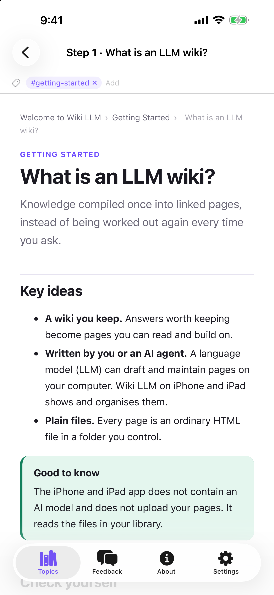
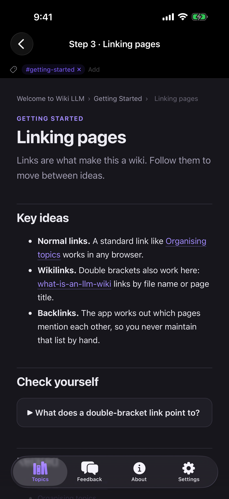
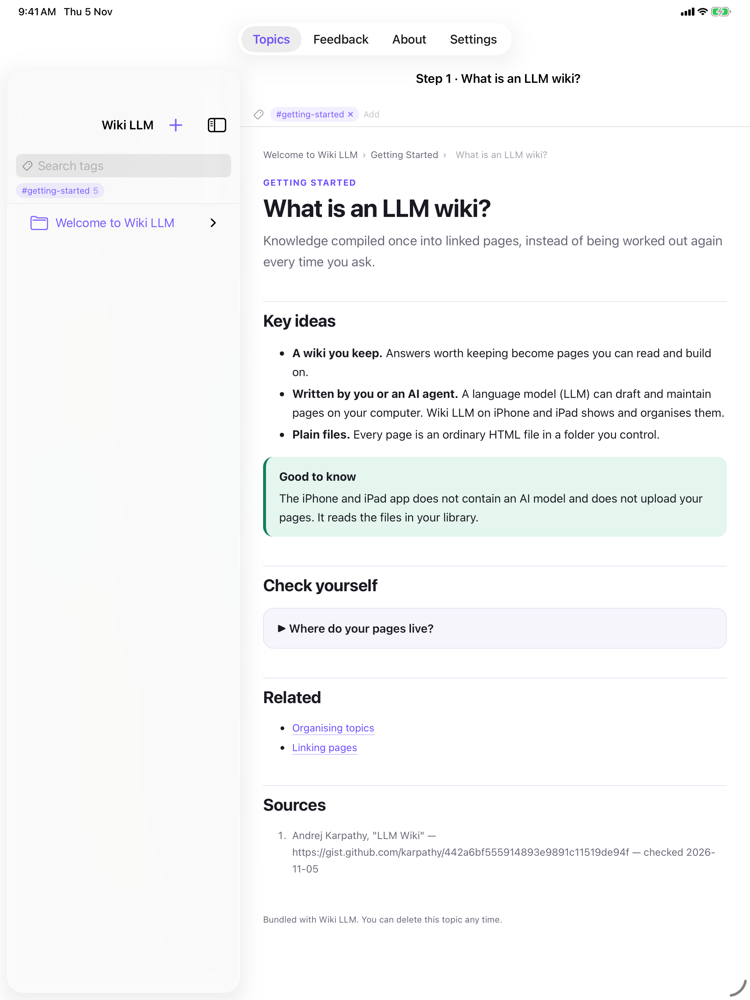

# Wiki LLM

A **native knowledge-building app for Mac, iPad and iPhone**. Knowledge lives in a **Topics
library**: a plain folder whose sub-folders are topics, each holding numbered subtopics and
self-contained **HTML pages** that can be visual, animated and interactive, with every formula in
LaTeX. On the Mac, **Claude Code** runs in a built-in terminal and leads a **team of nine agents**
that write and maintain those pages as an
[LLM wiki](https://gist.github.com/karpathy/442a6bf555914893e9891c11519de94f): one that captures
your own intuitions, tests and extends them, and turns them into notes you can explain to others.

[](https://developer.apple.com)
[](https://swift.org)
[](https://developer.apple.com/xcode/swiftui/)
[](https://github.com/migueldeicaza/SwiftTerm)
[](https://developer.apple.com/xcode/)
[](#license)

<a href="https://apps.apple.com/us/app/tertiary-markdown/id6782659815"></a>

> 📲 **Now on the App Store** — [**Download Wiki LLM**](https://apps.apple.com/us/app/tertiary-markdown/id6782659815) for Mac, iPad, and iPhone.

## Features

- 📚 **Topics library** — any folder can be a library. Topics, subtopics and pages are ordinary
  folders and `.html` files on disk, so nothing is locked into a proprietary store.
- 🌐 **Rich offline HTML pages** — pages copy one template, render offline and update on screen
  as soon as the file changes. Each library ships its own copies of KaTeX, D3, Observable Plot,
  JSXGraph, Mermaid, Matter.js and highlight.js in `_assets/`, for diagrams, animations, draggable
  constructions, simulations and charts. No CDNs.
- 🎙 **Voice notes to the agent** — WhatsApp-style, in a LahLah Voice–style white pill under the
  terminal with a live waveform: hold the mic (or the right ⌥ key, from any app), talk, release to
  send; slide left to cancel, up for hands-free. Whisper turns speech into text on your Mac, tuned
  to your library's vocabulary, so nothing leaves the machine.
- 🔍 **Enlarge any figure** — every diagram and image has an Enlarge button that opens it in a
  full-window popup with zoom in/out, fit and pan.
- ∑ **LaTeX everywhere** — formulas are written as LaTeX and typeset by KaTeX; the app renders
  LaTeX on any page that contains it, even one that forgot to load KaTeX.
- 🔗 **Obsidian-style links** — relative links and `[[wikilinks]]`, with hover previews, backlinks
  and outgoing links computed by the app.
- 🕸 **3D graph view** — every page as a node and every link as an edge, coloured by topic, with
  bridges between topics drawn bold. Hover to light up a page's neighbours, click to fly to it.
- 🔎 **Search** — plain words search titles, summaries, keywords and folders; `@word` searches tags
  (`@` alone lists them all).
- 🏷 **Tags and keywords** — stored in each page's own `<meta name="tags">` and
  `<meta name="keywords">`, so they stay with the files and plain text search finds a page by any
  of its names.
- 📝 **Markdown too** — `.md` files open in an Edit · Split · Preview editor with images, tables
  and interactive checklists.
- 🎨 **Light, Dark or System** appearance, which pages follow.
- 🍏 **One codebase, three platforms** — SwiftUI multiplatform.

### 🖥 Mac: the agent panel and the agent team

The right-hand panel holds the terminals: Claude Code, Codex and a plain shell, each in a real pty
([SwiftTerm](https://github.com/migueldeicaza/SwiftTerm)) started in the library folder, so Claude
Code follows the library's `CLAUDE.md`. Ask it in plain language, for example *Add a new topic
"Galois Theory"*, and the new topic appears in the sidebar. Sidebar menus offer one-click Outline,
Lint and Ingest, which type the instruction into Claude Code.

Claude Code starts with [agent teams](https://code.claude.com/docs/en/agent-teams) enabled, so the
main session leads the library's agents as teammates you can watch and message (↑/↓ and Enter under
the prompt). They run on your own Claude login; there is no API key.

| Agent | Job | Model |
| --- | --- | --- |
| Lead (main session) | Talks to you, writes original prose, runs the team | Opus |
| `wiki-researcher` | Research loop: hypotheses, tests, calculations | Opus |
| `wiki-idea-partner` | Generates and extends ideas | Opus |
| `wiki-cross-domain` | Brings ideas from other disciplines | Opus |
| `wiki-critic` | Challenges, questions and debates you | Opus |
| `wiki-visualizer` | Makes pages visual, animated and interactive | Opus |
| `wiki-collector` | Gathers content from the web and sources | Sonnet |
| `wiki-arxiv` | Searches arXiv papers | Sonnet |
| `wiki-reviewer` | Checks citations, numbers and labels | Sonnet |
| `wiki-organizer` | Files pages, tags, keywords and cross-links | Sonnet |

The team is active: each agent has standing duties it does unasked. Every intuition you offer goes
onto its page with the team's verdict (sound, needs a fix, or goes further), and concept pages end
with a "How to explain it" section, and every question you ask is kept in a compact Discussion
section at the bottom of its page. The Agents section of the sidebar shows every agent's
model, tools, skills and instructions.

> ⚠️ Claude Code runs with `--dangerously-skip-permissions`, in the library folder, so it can
> change files there without asking. Keep your library backed up.

## Screenshots

iPhone and iPad:

| iPhone — Page | iPhone — Dark | iPad — Page |
| --- | --- | --- |
|  |  |  |

## Tech Stack

| Area | Choice |
| --- | --- |
| Language | Swift 5 |
| UI | SwiftUI (multiplatform: iOS 17+ / macOS 14+) |
| Pages | `WKWebView` with a page script for wikilinks, hover previews and KaTeX |
| Page libraries | KaTeX, D3, Observable Plot, JSXGraph, Mermaid, Matter.js, highlight.js (offline) |
| Speech | [WhisperKit](https://github.com/argmaxinc/argmax-oss-swift) (Whisper large-v3 turbo, on-device) |
| Graph view | [3d-force-graph](https://github.com/vasturiano/3d-force-graph) (MIT, bundles three.js) |
| Markdown | Custom dependency-free block parser with native SwiftUI rendering |
| Terminal | [SwiftTerm](https://github.com/migueldeicaza/SwiftTerm) 1.11.2 (macOS) |
| Agents | [Claude Code](https://claude.com/claude-code) (agent teams) and Codex CLIs, installed separately |
| Project gen | [XcodeGen](https://github.com/yonaskolb/XcodeGen) (`project.yml`) |

## Architecture

```
Sources/
├─ MarkdownVaultApp.swift   # @main App + macOS menu commands
├─ RootView.swift           # macOS: TopicsRootView · iOS: TabView
├─ TopicsRootView.swift     # macOS: sidebar · page · agent panel
├─ TopicDetailView.swift    # Folder overview, page view (Preview / Split / Source), links bar
├─ AgentPanel.swift         # Agent tabs and terminal sessions (agent teams enabled)
├─ AgentsView.swift         # Sidebar Agents section: each agent's model, tools, instructions
├─ GraphView.swift          # 3D graph of the library's links
├─ HTMLPageView.swift       # WKWebView page rendering
├─ HTMLSourceEditor.swift   # HTML source editing
├─ WikiLinks.swift          # LinkIndex: backlinks, wikilinks, hover previews
├─ PageTags.swift           # Reads and writes tags in a page's <meta>
├─ TagViews.swift           # Search field (@tag), tag chips and layout
├─ TopicLibrary.swift       # Library layout, seeding and HTML generators
├─ VaultStore.swift         # Open library, file tree, live refresh, CRUD
├─ FileNode.swift           # File/folder tree model
├─ VaultView.swift          # iOS library browser
├─ MarkdownEditorView.swift # Edit · Split · Preview for .md files
├─ MarkdownParser.swift     # GFM-ish block parser
├─ MarkdownPreview.swift    # Native Markdown rendering
├─ Platform.swift           # Platform helpers
├─ Theme.swift              # Brand palette and appearance setting
├─ FeedbackView.swift       # Feedback form
├─ AboutView.swift          # App and developer info
└─ SettingsView.swift       # Library and display preferences
Resources/
├─ Graph/                   # graph.html + 3d-force-graph for the graph view
└─ LibraryTemplate/         # Seeded into new libraries where missing:
   ├─ CLAUDE.md             #   the schema the agent team follows
   ├─ _template.html        #   the page template
   ├─ _assets/              #   offline page libraries (KaTeX, D3, JSXGraph, Mermaid…)
   ├─ agents/               #   the nine wiki-* agents → .claude/agents/
   └─ skills/               #   deep-insight, insight-pages, latex-math, rich-visuals,
                            #   discussion, wiki-graph, new-page → .claude/skills/
Tools/mdwiki                # Legacy helper for Markdown wikis, not used by Topics libraries
```

## Getting Started

Requirements: **macOS 14+**, **Xcode 26+** and [XcodeGen](https://github.com/yonaskolb/XcodeGen)
(`brew install xcodegen`). The agent panel also needs the
[Claude Code](https://claude.com/claude-code) CLI on your `PATH`.

```bash
git clone https://github.com/alfredang/wikillmapp.git
cd wikillmapp
xcodegen generate            # creates MarkdownVault.xcodeproj from project.yml
open MarkdownVault.xcodeproj # build & run for My Mac, an iPad or an iPhone
```

Or from the command line:

```bash
# macOS
xcodebuild -project MarkdownVault.xcodeproj -scheme MarkdownVault -destination 'platform=macOS' build
# iOS Simulator
xcodebuild -project MarkdownVault.xcodeproj -scheme MarkdownVault -destination 'generic/platform=iOS Simulator' build
```

On first launch the app creates a library at `~/Documents/Tertiary Topics` (app Documents on iOS).
Use ⌘O to open any other folder as a library.

**On iPhone and iPad:** if your Mac syncs Desktop & Documents to iCloud, the library is already in
iCloud Drive. In the iOS app, open the folder (Files › iCloud Drive › Documents › Tertiary Topics);
the app downloads every page and picks up the Mac's changes whenever you come back to it.

> The Mac build in this repo runs **without the App Sandbox** so its terminals can start a real
> login shell. That makes this build **not App Store eligible**; keep it for personal and
> development use.

## How a library is laid out

```
<library>/
├─ CLAUDE.md          # Schema the agent team follows
├─ .claude/agents/    # The wiki-* agents
├─ .claude/skills/    # deep-insight, insight-pages, latex-math, rich-visuals, discussion, wiki-graph, new-page
├─ _template.html     # Template every page starts from
├─ _assets/           # Offline libraries pages load by relative path
└─ <Topic>/
   ├─ index.html      # Topic home
   ├─ log.md          # Append-only operations log
   ├─ raw/            # Immutable sources
   ├─ runs/           # Scripts and outputs behind computed results
   └─ 01 Subtopic/
      ├─ index.html
      └─ some-page.html
```

## Developer

**Tertiary Infotech Academy Pte Ltd** — [tertiaryinfotech.com](https://www.tertiaryinfotech.com)

## License

MIT. Bundled third-party libraries keep their own licenses (KaTeX, Mermaid, Matter.js,
3d-force-graph: MIT; D3, Observable Plot: ISC; JSXGraph: MIT or LGPL; highlight.js: BSD-3-Clause);
license files sit beside each library in `Resources/`.
